<p align="center">
  
</p>

<h1 align="center">Palo Alto Networks | NGFW Security Policy & Network Implementation</h1>

<p align="center"><strong>Personal Infrastructure Engineering Project</strong></p>

<p align="center">Physical appliance restoration · PAN-OS CLI administration · Layer 3 networking · Security policy · Source NAT</p>

<p align="center"><strong>PAN-OS 11.1.4-h7</strong> &nbsp;|&nbsp; <strong>Serial console / Tera Term</strong> &nbsp;|&nbsp; <strong>November 9, 2026</strong></p>

---

## Project Overview

I restored and configured a physical Palo Alto Networks next-generation firewall as an independent infrastructure engineering project. The implementation covered appliance recovery, configuration inspection, network segmentation, routing, application-aware security policies, and outbound source address translation.

All changes were made through the local maintenance interface and PAN-OS CLI. I reviewed the candidate configuration, completed full validation, committed the changes, and captured the resulting operational configuration. **Both the validation and manual commit completed successfully (`FIN / OK`).**

The work was performed on isolated enterprise hardware. The configuration and commit are verified in the terminal evidence; live connectivity and traffic enforcement were not tested. That distinction is retained in the results section rather than treating a successful commit as proof of a functioning external network.

### Implementation Workflow

The implementation followed a controlled sequence from appliance restoration through configuration validation and final evidence capture.

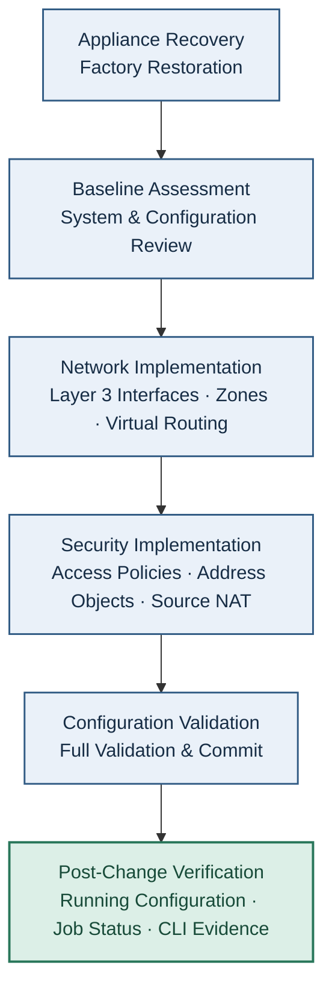

<br>

### Security Policy & Traffic Workflow

The diagram below summarizes the logical rule decisions and source NAT configuration. It represents the configured policy intent, not a live packet-flow test.

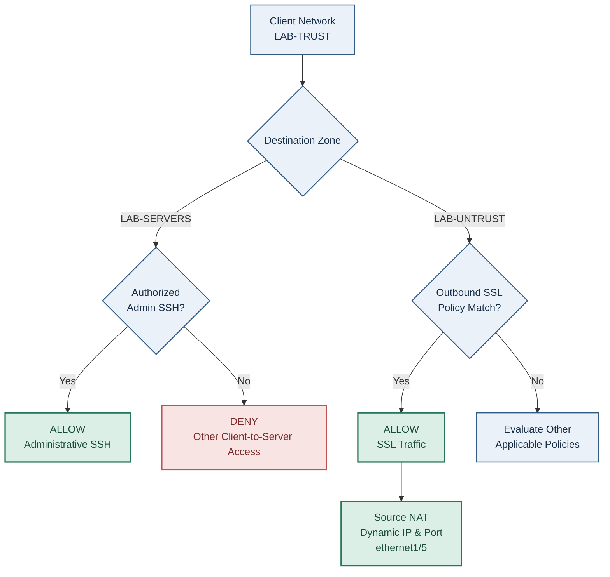

<br>

### Contents

1. [Network architecture](#architecture)
2. [Appliance recovery and restoration](#restoration)
3. [Console access and baseline assessment](#baseline)
4. [Layer 3 networking and virtual routing](#network)
5. [Address and service objects](#objects)
6. [Security policy implementation](#policies)
7. [Source NAT and configuration review](#nat)
8. [Configuration validation and commit](#commit)
9. [Post-change verification](#verification)
10. [Implementation results](#results)
11. [Repository contents](#repository)

<br>

---

<a id="architecture"></a>
## 01 — Network Architecture

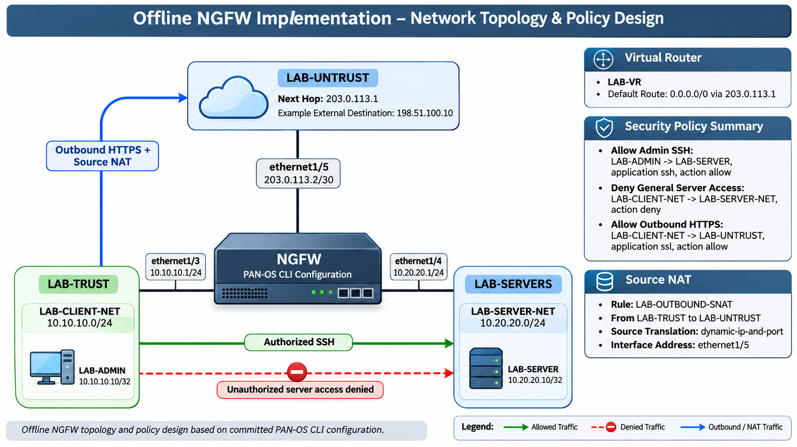

*Figure 1 — Logical topology of the configured interfaces, security zones, virtual router, security rules, and outbound source NAT.*

<br>

| Interface | Security zone | IP address | Configuration role |
|:---|:---|:---|:---|
| `ethernet1/3` | `LAB-TRUST` | `10.10.10.1/24` | Client network gateway |
| `ethernet1/4` | `LAB-SERVERS` | `10.20.20.1/24` | Server network gateway |
| `ethernet1/5` | `LAB-UNTRUST` | `203.0.113.2/30` | External-facing interface and NAT egress |

The three interfaces were assigned to virtual router `LAB-VR`. A named default route, `LAB-DEFAULT`, was configured with `ethernet1/5` as its egress interface and `203.0.113.1` as the next hop.

The addresses in the external-facing segment are reserved documentation addresses, not an active ISP allocation. All PAN-OS object names are preserved exactly as configured, including the `LAB-*` identifiers.

The arrows in the topology illustrate the intended policy paths, not observed packet captures.

[Back to contents](#contents)

---

<a id="restoration"></a>
## 02 — Appliance Recovery and Restoration

The work began with a review of the appliance's boot sequence and entry into its maintenance environment. Factory restoration and storage scrubbing were completed before the new configuration was applied.

### Boot and recovery

**Figure 2 — Bootloader and hardware initialization**  
Startup output showing memory initialization and storage detection. Hardware identifiers are redacted.

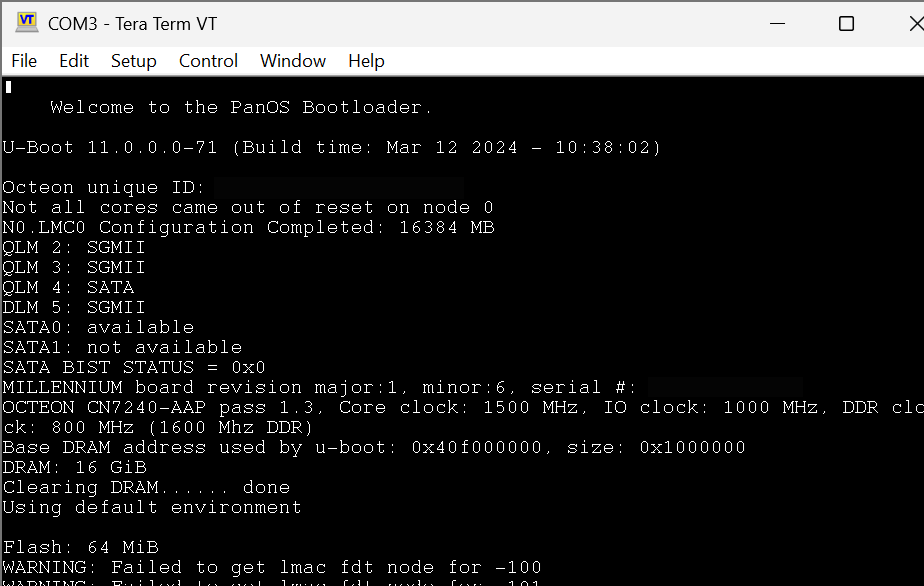

<br>

**Figure 3 — Maintenance recovery environment**  
Local recovery access before restoration.

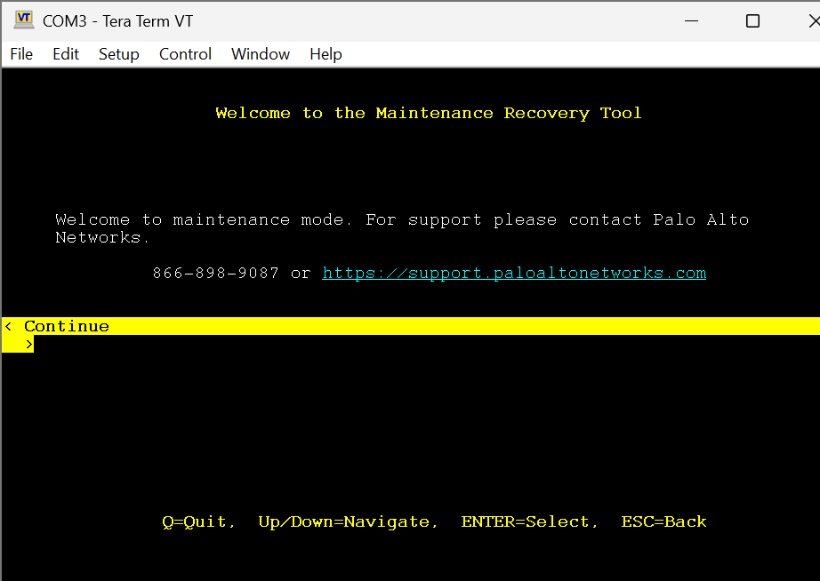

<br>

### Factory restoration

**Figure 4 — Restoration and scrub selections**  
Recovery options selected for the reset procedure.

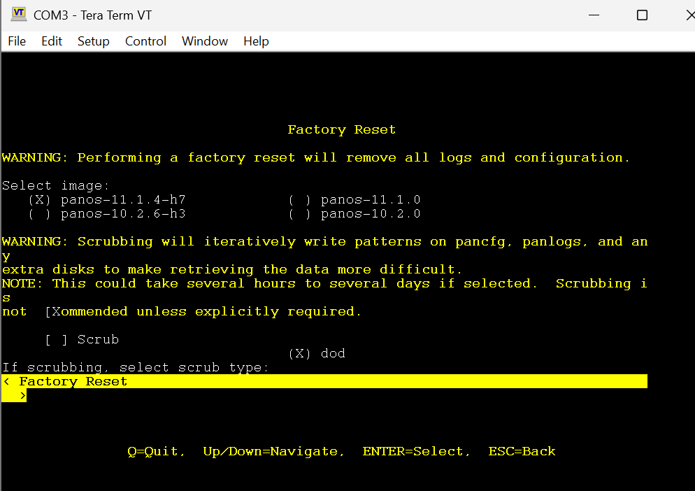

<br>

**Figure 5 — Storage scrub execution**  
Progress output from the maintenance recovery operation.

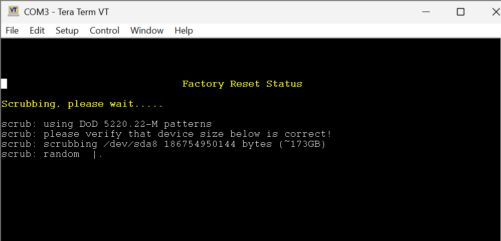

<br>

**Figure 6 — Restoration result**  
The appliance reports `Scrub Status: Success` and `Factory Reset Status: Success`.

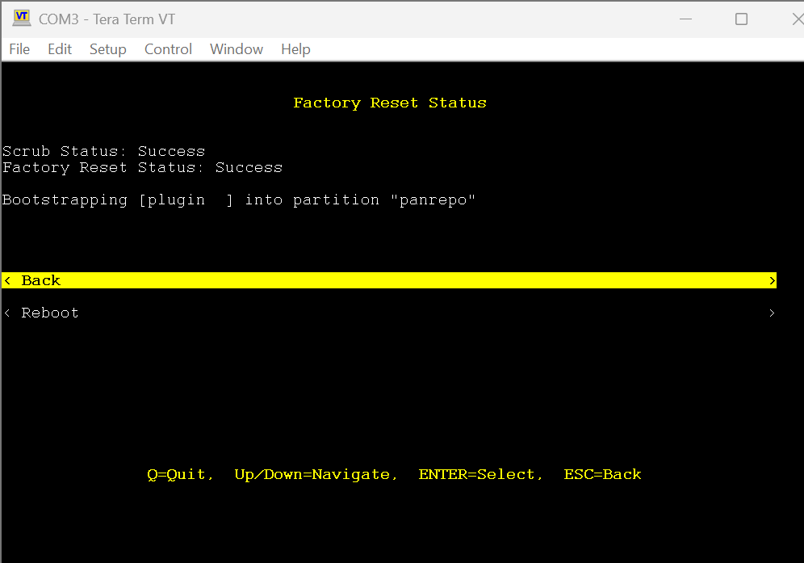

These are the outcomes reported by the recovery interface. The screenshots document the restoration procedure and its status; they are not independent certification of a particular data-erasure standard.

[Back to contents](#contents)

---

<a id="baseline"></a>
## 03 — Console Access and Baseline Assessment

I accessed PAN-OS through a direct serial console session. After the initial administrator password-change interaction, I adjusted CLI output formatting, inspected local logs, and reviewed the configuration and storage state before making network changes.

### Console preparation

```text
set cli terminal height 500
set cli terminal width 500
clear log system
show log system
```

**Command purpose**

- `set cli terminal height 500` — Extends terminal output height to reduce pagination during long captures.
- `set cli terminal width 500` — Expands the logical output width to reduce line wrapping.
- `clear log system` — Clears local system logs following confirmation, as part of the recorded post-reset procedure. It is a destructive action and not a routine maintenance recommendation.
- `show log system` — Inspects the resulting system-log state; no entries were shown in this capture.

**Figure 7 — Administrative console preparation and log inspection**

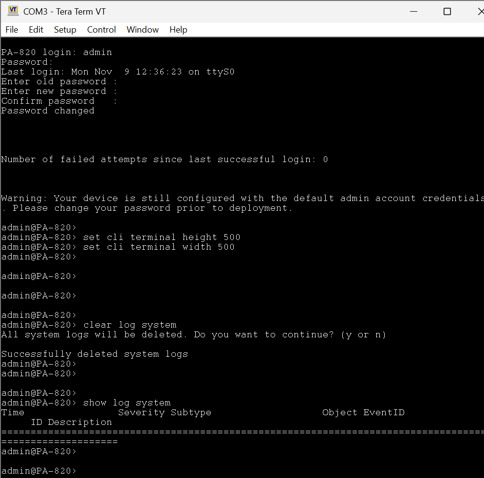

<br>

### Baseline configuration and storage

```text
show vlan all
show config saved running-config.xml
show config saved candidate-config
show config running
show system disk-space
```

**Command purpose**

- `show vlan all` — Requests VLAN configuration. The captured response was `Server error : vlan configuration not found`.
- `show config saved running-config.xml` — Displays the saved running-configuration XML for baseline inspection.
- `show config saved candidate-config` — Displays the saved candidate configuration for comparison.
- `show config running` — Reviews the currently committed configuration.
- `show system disk-space` — Checks filesystem capacity and utilization.

**Figure 8 — VLAN query and saved configuration review**

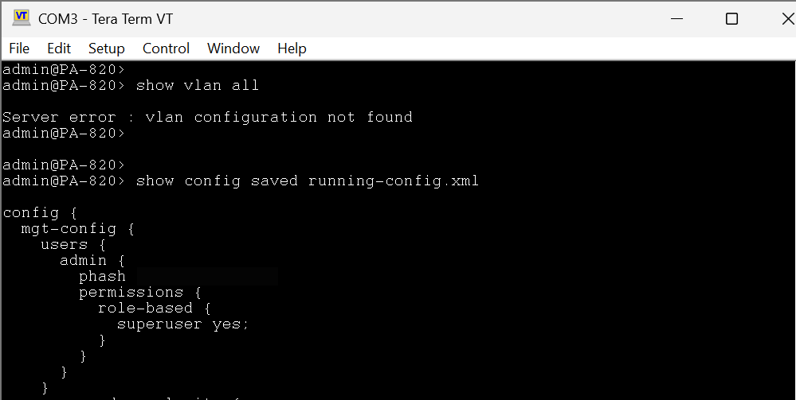

<br>

**Figure 9 — Candidate configuration inspection**

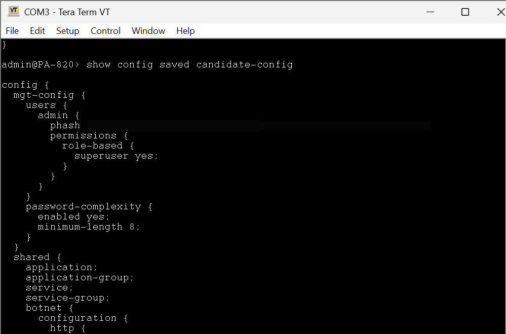

<br>

**Figure 10 — Saved running configuration**

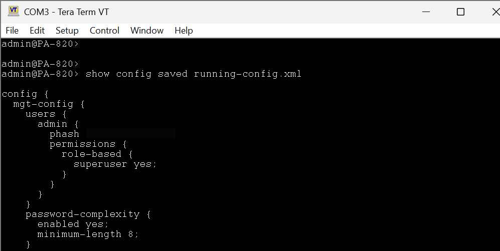

<br>

**Figure 11 — Committed configuration inspection**

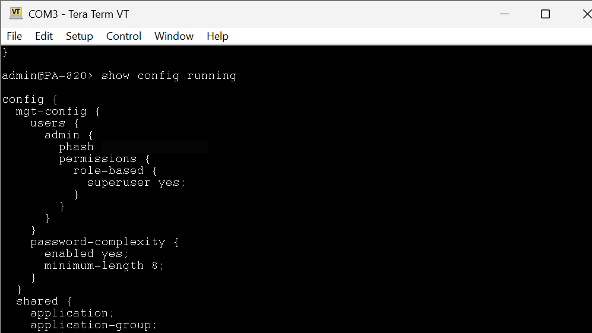

<br>

**Figure 12 — System information and storage utilization**

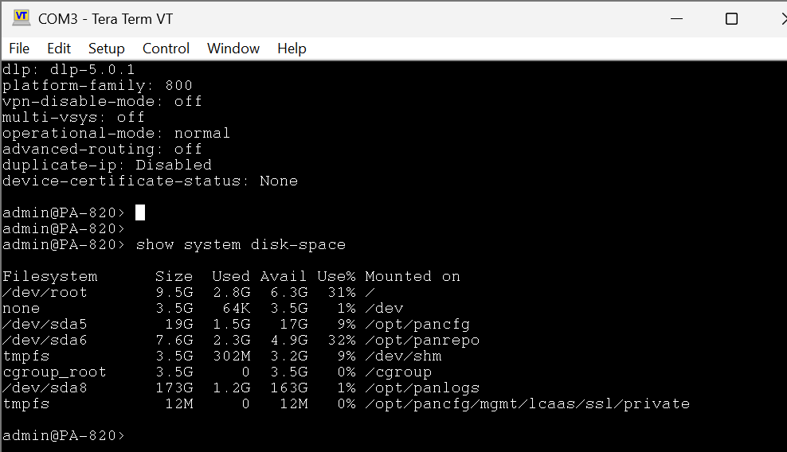

The baseline review established the system state before interface assignments, routing, and security policy changes were introduced.

[Back to contents](#contents)

---

<a id="network"></a>
## 04 — Layer 3 Networking and Virtual Routing

### Interface addressing

```text
configure
set network interface ethernet ethernet1/3 layer3 ip 10.10.10.1/24
set network interface ethernet ethernet1/4 layer3 ip 10.20.20.1/24
set network interface ethernet ethernet1/5 layer3 ip 203.0.113.2/30
```

`configure` enters candidate-configuration mode. Each interface command assigns a Layer 3 address to its designated Ethernet port: the client network on `ethernet1/3`, the server network on `ethernet1/4`, and the external-facing segment on `ethernet1/5`.

### Security-zone assignment

```text
set zone LAB-TRUST network layer3 ethernet1/3
set zone LAB-SERVERS network layer3 ethernet1/4
set zone LAB-UNTRUST network layer3 ethernet1/5
```

These commands bind each Layer 3 interface to a named security zone. The zone relationships are then used by interzone security policies and NAT rules.

**Figure 13 — Interface addressing, zones, and initial routing configuration**

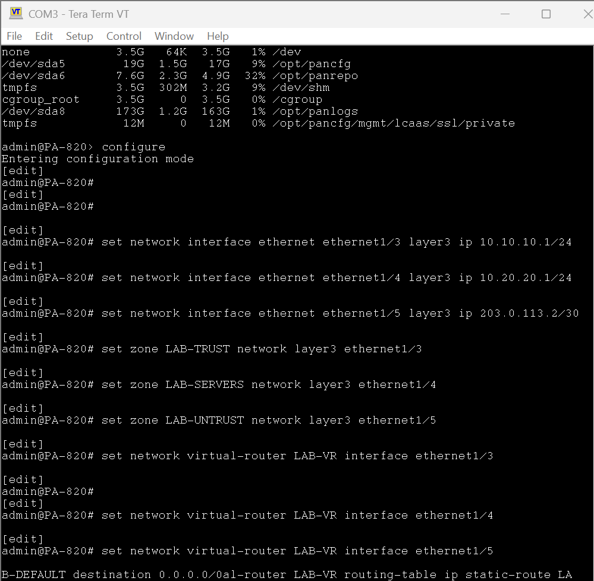

<br>

### Virtual router and default route

```text
set network virtual-router LAB-VR interface ethernet1/3
set network virtual-router LAB-VR interface ethernet1/4
set network virtual-router LAB-VR interface ethernet1/5
set network virtual-router LAB-VR routing-table ip static-route LAB-DEFAULT destination 0.0.0.0/0 interface ethernet1/5 nexthop ip-address 203.0.113.1
```

The first three commands register the interfaces with `LAB-VR`, defining their common Layer 3 routing context.

The last command creates `LAB-DEFAULT`, a configured route for destinations matching `0.0.0.0/0`, pointing to `203.0.113.1` through `ethernet1/5`. This establishes the intended path in the configuration; active route installation is assessed separately using operational commands.

[Back to contents](#contents)

---

<a id="objects"></a>
## 05 — Address and Service Objects

```text
set address LAB-CLIENT-NET ip-netmask 10.10.10.0/24
set address LAB-SERVER-NET ip-netmask 10.20.20.0/24
set address LAB-ADMIN ip-netmask 10.10.10.10/32
set address LAB-SERVER ip-netmask 10.20.20.10/32
set service LAB-HTTPS protocol tcp port 443
```

The first two commands create reusable network objects for the client and server subnets. The `/32` objects identify a single administrative source and destination server so the SSH exception can be limited to those hosts.

The final command defines a TCP/443 service object. That object was created in the configuration; the outbound SSL security rule below uses `application-default` rather than referencing this object.

**Figure 14 — Static route completion and object creation**

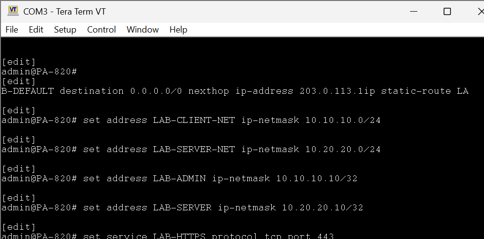

[Back to contents](#contents)

---

<a id="policies"></a>
## 06 — Security Policy Implementation

The security rulebase was configured for a specific administrative SSH exception, a broader client-to-server restriction, and outbound SSL access. Rule order matters because the narrow SSH allowance must be evaluated before the broader server-access deny.

### Authorized administrative SSH

```text
set rulebase security rules LAB-Allow-Admin-SSH from LAB-TRUST to LAB-SERVERS source LAB-ADMIN destination LAB-SERVER application ssh service application-default action allow
```

Permits the `ssh` application from `LAB-ADMIN` (`10.10.10.10/32`) to `LAB-SERVER` (`10.20.20.10/32`) using the application's default service behavior.

### Client-to-server restriction

```text
set rulebase security rules LAB-Deny-Server-Access from LAB-TRUST to LAB-SERVERS source LAB-CLIENT-NET destination LAB-SERVER-NET application any service any action deny
```

Denies traffic matching the specified client and server subnets, zones, and unrestricted application/service criteria. The more specific SSH allowance precedes this rule.

### Outbound SSL and session-end logging

```text
set rulebase security rules LAB-Allow-HTTPS from LAB-TRUST to LAB-UNTRUST source LAB-CLIENT-NET destination any application ssl service application-default action allow
set rulebase security rules LAB-Allow-HTTPS log-end yes
```

The first command creates an application-aware `ssl` allow rule from the client subnet toward the external-facing zone, constrained to the application's default service behavior.

The second command enables logging at session end for that rule. It configures logging behavior but does not, by itself, demonstrate a recorded session.

**Figure 15 — Security-rule configuration and logging setting**

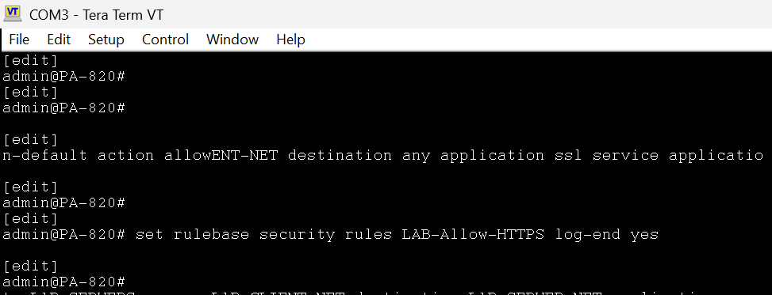

[Back to contents](#contents)

---

<a id="nat"></a>
## 07 — Source NAT and Configuration Review

### Source address translation

```text
set rulebase nat rules LAB-OUTBOUND-SNAT from LAB-TRUST to LAB-UNTRUST source LAB-CLIENT-NET destination any service any to-interface ethernet1/5 source-translation dynamic-ip-and-port interface-address interface ethernet1/5
```

`LAB-OUTBOUND-SNAT` matches outbound traffic from `LAB-CLIENT-NET` within `LAB-TRUST` toward `LAB-UNTRUST` through `ethernet1/5`.

`dynamic-ip-and-port` specifies source-address and port translation, using the address configured on `ethernet1/5` as the translated source. This is an outbound source NAT rule, not destination NAT or inbound port forwarding.

### Candidate review

```text
show network
show zone
show address
show rulebase security
show rulebase nat
```

**Command purpose**

- `show network` — Reviews interfaces, configured addressing, and virtual routing.
- `show zone` — Confirms security-zone definitions and interface membership.
- `show address` — Reviews network and host address objects.
- `show rulebase security` — Inspects the security rule definitions and their match conditions.
- `show rulebase nat` — Inspects the source NAT rule and translation method.

**Figure 16 — Candidate network configuration**

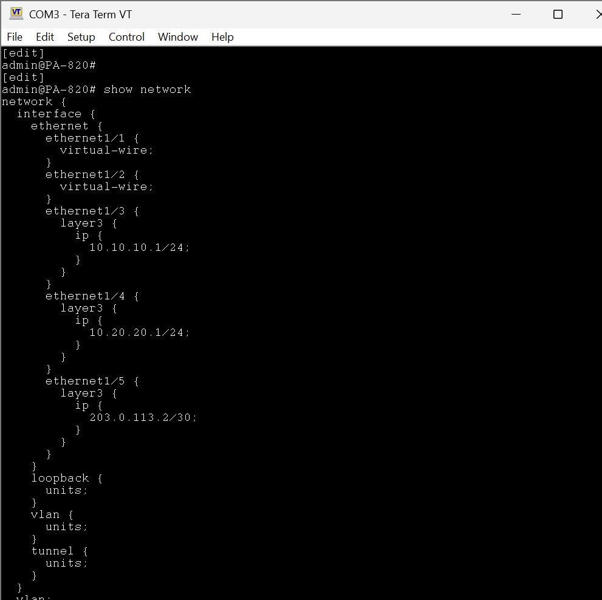

<br>

**Figure 17 — Security-zone review**

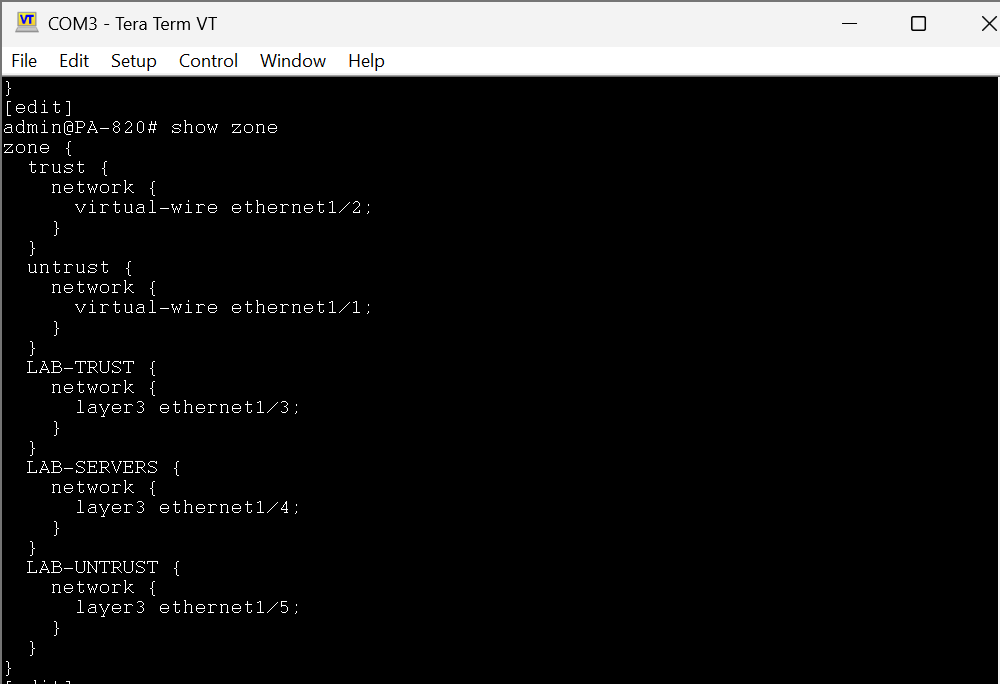

<br>

**Figure 18 — Address objects and security policies**

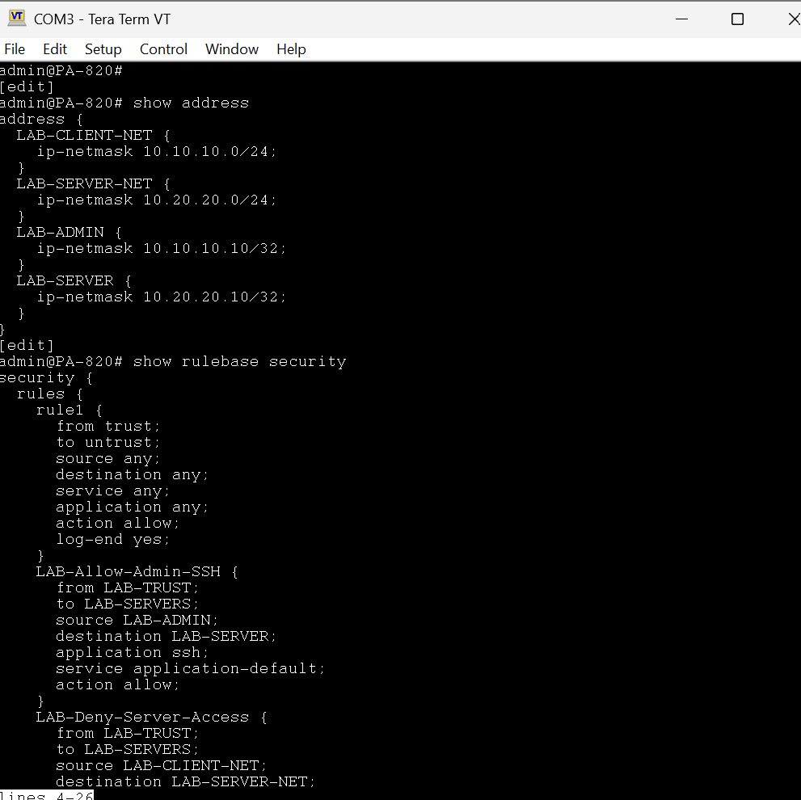

<br>

**Figure 19 — NAT configuration and validation request**

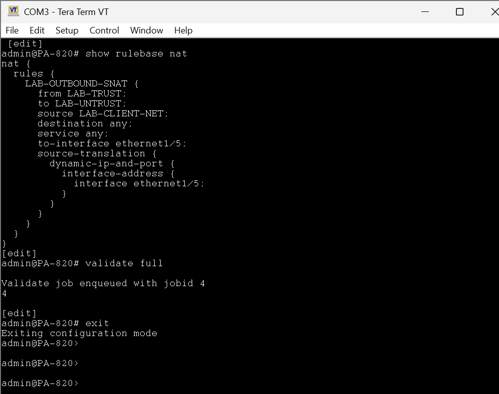

The original configuration also contained lowercase `trust` and `untrust` virtual-wire zones. These remain distinct from the three newly configured `LAB-*` Layer 3 zones.

[Back to contents](#contents)

---

<a id="commit"></a>
## 08 — Configuration Validation and Commit

After inspecting the candidate configuration, I performed full validation, reviewed the resulting job, and committed the changes.

```text
validate full
exit
show jobs all
configure
commit
exit
show jobs all
```

**Command purpose**

- `validate full` — Runs full candidate-configuration validation without committing the pending changes.
- `exit` — Returns from configuration mode to operational mode.
- `show jobs all` — Displays the validation job and its completion status.
- `configure` — Re-enters candidate-configuration mode for the approved change.
- `commit` — Applies the candidate configuration to the running configuration.
- `exit` / `show jobs all` — Returns to operational mode and confirms the post-commit job status.

**Figure 20 — Validation and manual commit execution**

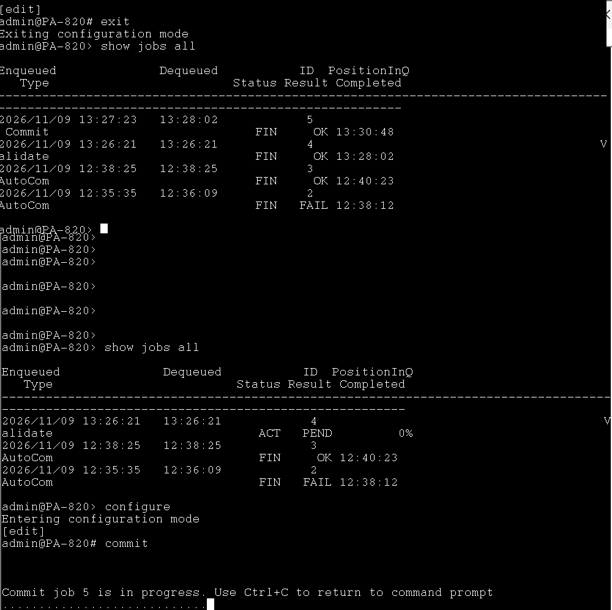

<br>

**Figure 21 — Job completion records**  
Validation job **4** and manual commit job **5** both show **`FIN / OK`**.

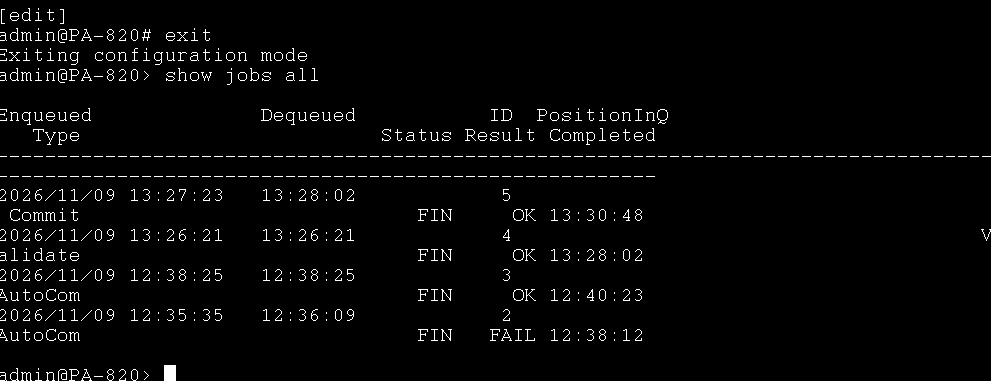

An earlier automatic commit appears in the job history as **`FIN / FAIL`** (job 2). The reason is not established by the captured output. The successful validation and subsequent manual commit are documented as separate completed operations.

[Back to contents](#contents)

---

<a id="verification"></a>
## 09 — Post-Change Verification

The final operational review examined software details, Ethernet link status, routing, applied security policy, applied NAT, and commit-job history.

```text
show system info
show interface all
show routing route
show running security-policy
show running nat-policy
show jobs all
set cli config-output-format set
show config running
```

**Command purpose**

- `show system info` — Displays software release and device metadata.
- `show interface all` — Reports interface addresses, logical associations, and physical link state.
- `show routing route` — Inspects routes installed in the operational routing table.
- `show running security-policy` — Reviews applied security policy after commit.
- `show running nat-policy` — Reviews applied NAT policy after commit.
- `show jobs all` — Confirms the outcome of validation and commit operations.
- `set cli config-output-format set` — Requests set-style CLI configuration output where supported; the captured follow-up output remains hierarchical.
- `show config running` — Displays committed configuration content for the final inspection.

**Figure 22 — Software and system information**

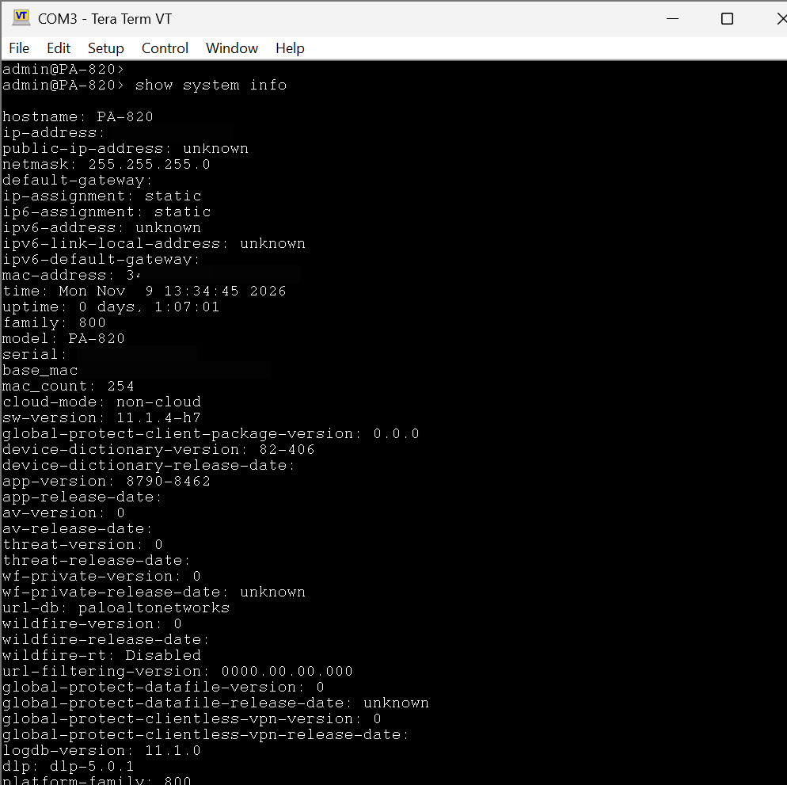

<br>

**Figure 23 — Configured interfaces and link status**  
The relevant Ethernet links report **down** in the capture.

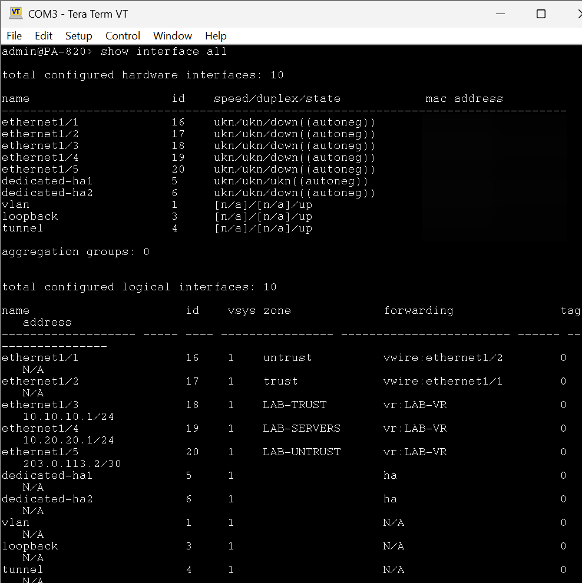

<br>

**Figure 24 — Operational routing and running security policy**  
`LAB-VR` reports **`total routes shown 0`** at the time of inspection.

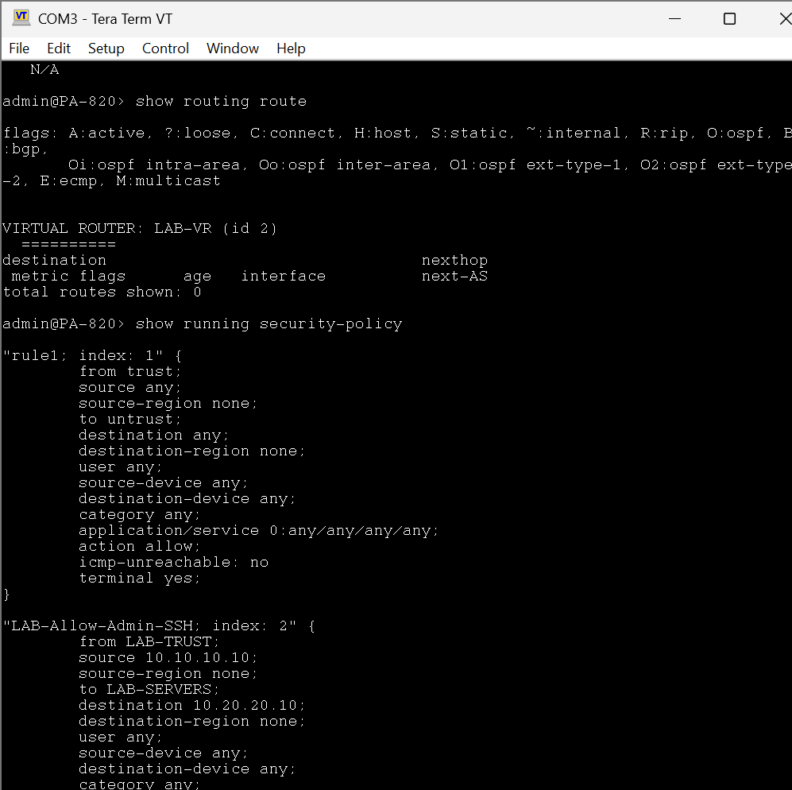

<br>

**Figure 25 — Running NAT policy and job status**

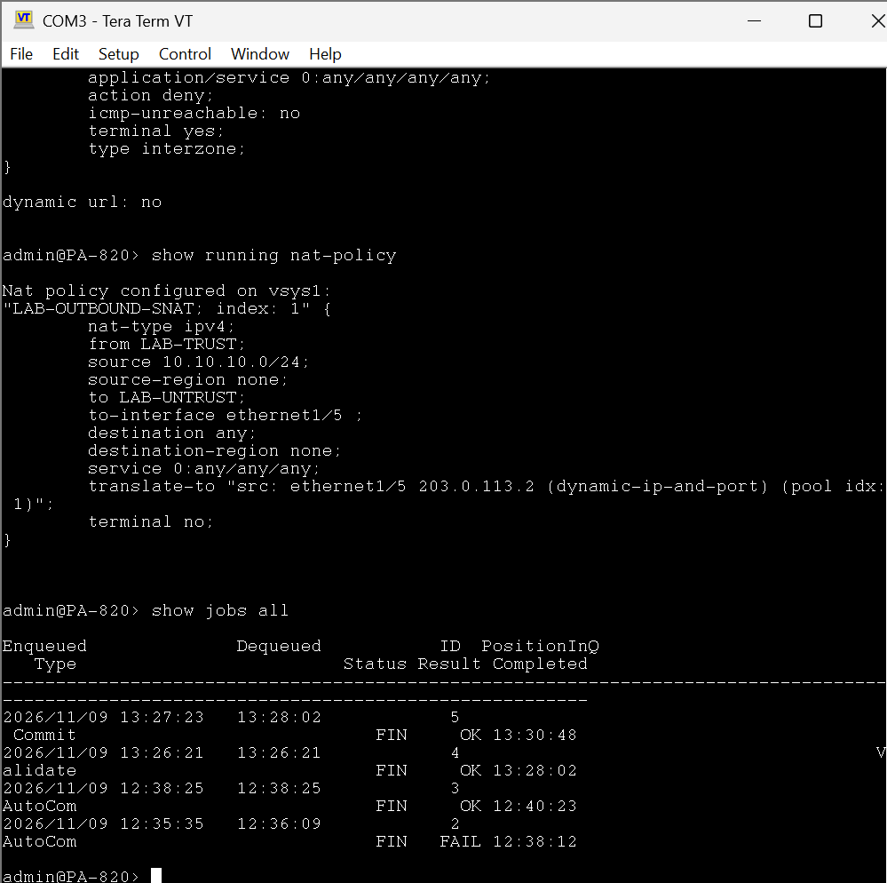

<br>

**Figure 26 — Final NAT and running-configuration review**

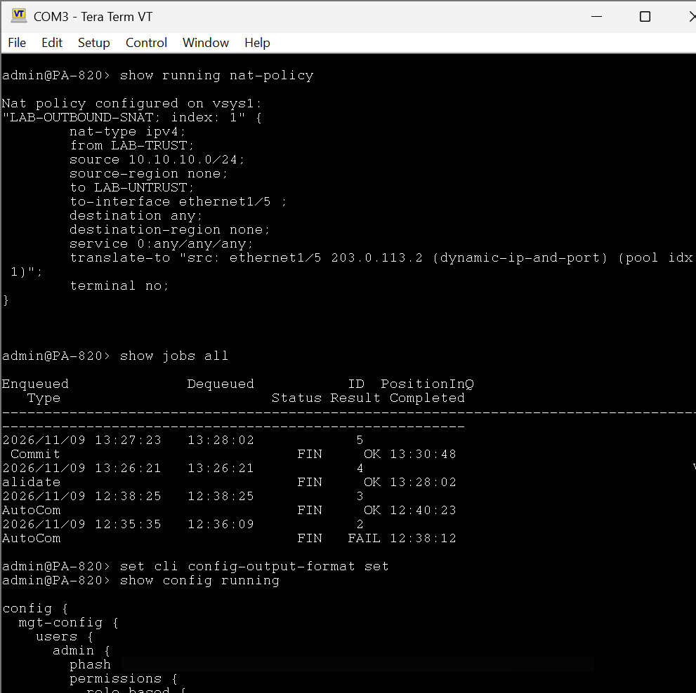

The completed configuration was present and the commit succeeded. Because the relevant interfaces were disconnected, the configured default route was not installed as an active route and no end-to-end forwarding or policy-match outcome is asserted.

[Back to contents](#contents)

---

<a id="results"></a>
## 10 — Implementation Results

| Area | Recorded outcome |
|:---|:---|
| Appliance restoration | Factory reset and storage scrub reported success |
| Layer 3 configuration | Three interfaces addressed and assigned to security zones |
| Virtual routing | `LAB-VR` configured with `LAB-DEFAULT` static route |
| Security policy | Administrative SSH allow, broader server-access deny, and outbound SSL allow |
| Source NAT | Dynamic IP-and-port translation through `ethernet1/5` |
| Full validation | Job `4` — **`FIN / OK`** |
| Manual commit | Job `5` — **`FIN / OK`** |
| Operational review | Configured interfaces down; routing table contained zero active routes |

This project establishes successful appliance restoration, PAN-OS configuration, candidate review, validation, manual commit, and post-change inspection. It does not claim live data-plane connectivity, successful policy-match tests, or an operating upstream network.

The running policy output includes a pre-existing `rule1` tied to the appliance's original lowercase `trust` and `untrust` zones. It is not represented as part of the newly configured three-rule policy design.

**Evidence handling:** The 25 console screenshots have been redacted to obscure serial numbers, MAC addresses, credential hashes, and other sensitive identifiers. Configuration names, interface references, and addressing relevant to the technical work are retained.

[Back to contents](#contents)

---

<a id="repository"></a>
## 11 — Repository Contents

```text
.
├── README.md
├── assets/
│   ├── brandons-logo.png
│   └── topology.png
└── evidence/
    ├── s1.png
    ├── s2.png
    ├── ...
    └── s25.png
```

The `assets/` directory contains the topology diagram and personal branding. The `evidence/` directory contains the redacted console captures shown throughout this implementation record.

---

<p align="center">
  
</p>

<p align="center">
  <strong>Brandon Stevenson</strong>
</p>

<p align="center">
  IT Infrastructure · Enterprise Networking · Systems Administration · Software Programming
</p>

<p align="center">
  <sub>
    Microsoft Azure Fundamentals (AZ-900) · A.A.S. Computer Information Technology (Software Programming)<br>
    B.S. Cloud & Network Engineering — Western Governors University (In Progress)
  </sub>
</p>

<p align="center">
  <a href="https://www.brandons-resume.com/">Portfolio &amp; Résumé</a>
  &nbsp;&nbsp;|&nbsp;&nbsp;
  <a href="https://www.linkedin.com/in/brandon-in-tech/">LinkedIn</a>
  &nbsp;&nbsp;|&nbsp;&nbsp;
  <a href="https://github.com/brandon-in-tech">GitHub</a>
</p>
